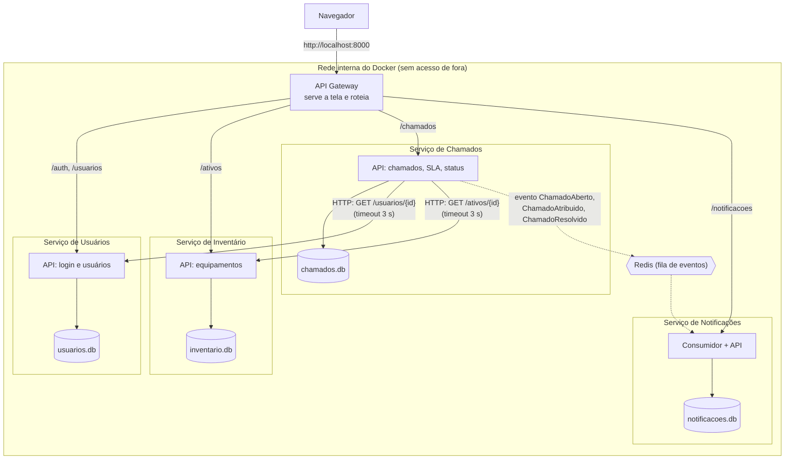

# HelpDesk TI · microsserviços

Sistema de chamados de TI separado em **microsserviços** (Python + FastAPI + Docker Compose).
Esta é a versão em microsserviços do monólito [prof-filipecavalcante/helpdesk-ti](https://github.com/prof-filipecavalcante/helpdesk-ti),
feita para a atividade de Arquitetura de Software. A tela e as regras de negócio são as mesmas.

## Como rodar

```bash
docker compose up --build
```

Depois abra **http://localhost:8000** (a tela). Não precisa criar `.env`: um serviço auxiliar (`segredo`)
gera um segredo aleatório para os logins na primeira subida. Para usar o seu, copie `.env.example` para `.env`.

Contas de exemplo (senha **`Helpdesk2026`**): `admin@empresa.com`, `carla@empresa.com` e `diego@empresa.com` (técnicos),
`ana@empresa.com` e `bruno@empresa.com` (solicitantes). Perfis e permissões: iguais ao monólito.

Para parar e apagar os dados: `docker compose down -v`.

## Arquitetura



| Serviço | Responsabilidade | Banco (arquivo próprio) | Fala com |
|---|---|---|---|
| **gateway** (porta 8000, a única exposta) | Serve a tela e encaminha `/auth`, `/usuarios`, `/ativos`, `/chamados`, `/notificacoes` | nenhum | todos |
| **usuarios** | Cadastro de usuários, login, **emite** o JWT | `usuarios.db` | ninguém |
| **inventario** | Equipamentos de TI | `inventario.db` | ninguém |
| **chamados** | Chamados, SLA, status, comentários, painel | `chamados.db` | Usuários e Inventário (HTTP), Redis (publica) |
| **notificacoes** | Guarda os avisos de cada usuário | `notificacoes.db` | Redis (consome) |

```
helpdesk-microsservicos/
├── docker-compose.yml
├── gateway/               # FastAPI + httpx; contém a tela (app/web)
├── servicos/
│   ├── usuarios/          # cada serviço tem app/, tests/, Dockerfile e requirements.txt próprios
│   ├── inventario/
│   ├── chamados/
│   └── notificacoes/
├── executar-testes.sh
└── .github/workflows/testes.yml
```

## O que mudou em relação ao monólito

| No monólito | Em microsserviços |
|---|---|
| `inventario.obter(db, id)` (chamada de função) | `GET http://inventario:8000/ativos/{id}` com timeout (`chamados/app/clientes.py`) |
| `usuarios.obter_tecnico(db, id)` | `GET http://usuarios:8000/usuarios/{id}` e a verificação do perfil `tecnico` é feita em Chamados |
| `notificacoes.notificar(...)` | Evento publicado no Redis; Notificações consome e grava (`eventos.py` / `consumidor.py`) |
| Chaves estrangeiras `chamados → usuarios/ativos` | Só guardamos o **número** (`solicitante_id`, `tecnico_id`, `ativo_id`); sem FK entre bancos |
| Um banco único | Um banco SQLite por serviço, cada um em seu volume Docker |
| `usuario_atual` consulta o banco de usuários | Cada serviço confere o **JWT** (assinatura, emissor, validade, perfil) sem consultar ninguém |
| Uma tela servida pelo app | A tela é servida pelo gateway; ela continua chamando as mesmas rotas |

As regras (SLA de 4/8/24/72 h, transições `aberto → em_atendimento → resolvido → fechado`, reabrir, permissões por perfil)
foram copiadas sem alteração para `servicos/chamados/app/servico.py`.

## Decisões de arquitetura

1. **Nome do serviço, não `localhost`.** Dentro do Compose cada contêiner é um "computador" diferente; `http://usuarios:8000` funciona, `localhost` não.
2. **Timeout em toda chamada entre serviços** (3 s no total, 1 s para conectar). Sem isso, um Inventário lento prenderia as requisições de Chamados.
3. **Falha clara, não genérica.** Se Inventário ou Usuários estiver fora do ar, Chamados responde **503** com a mensagem `O serviço de Inventário está indisponível...` e `Retry-After`. O gateway responde 503/504 se um serviço inteiro não responder.
4. **Degradação parcial.** Com o Inventário fora, ainda dá para listar e abrir chamados *sem equipamento*, resolver, comentar, etc. Só o que depende do Inventário falha.
5. **Segurança em cada serviço (defesa em profundidade).** O gateway **não** é o guarda: ele repassa o `Authorization`, e **cada serviço** confere o JWT. Quem acessar um serviço direto (sem o gateway) continua barrado.
6. **Segredo compartilhado fora do código.** Todos os serviços precisam do mesmo `JWT_SEGREDO` (mínimo 32 caracteres). Ele vem do `.env`, ou de um volume criado pelo serviço `segredo`; se faltar, o serviço **recusa subir** (não gera segredo aleatório, como o monólito fazia, pois aí cada serviço teria um diferente).
7. **O perfil vem dentro do token.** Assim Chamados, Inventário e Notificações não precisam consultar Usuários a cada pedido. Custo: se uma conta for desativada, o token antigo continua valendo até vencer (60 min). Só o serviço de Usuários checa a conta no banco.
8. **Eventos "dispare e esqueça" com Redis Streams.** Chamados publica depois de salvar. Notificações usa *consumer group* e só confirma (ACK) depois de gravar, então eventos pendentes são relidos se ele cair. Se o Redis estiver fora, o chamado é salvo normalmente e o erro vai para o log: o aviso se perde, o sistema não para.
9. **Rede interna.** Só o gateway tem porta publicada (`127.0.0.1:8000`); a rede `interna` do Compose não tem acesso à internet.

### Limitações conhecidas (e como seriam resolvidas)

- **Publicar evento após salvar não é atômico**: se o Chamados cair entre as duas coisas, o aviso se perde. A solução clássica é o padrão *outbox*.
- **O limite de tentativas de login fica em memória** do serviço de Usuários (como no monólito). Com várias instâncias, usar Redis.
- **Ids de exemplo combinados por convenção** (Ana = 2, Carla = 4, equipamento 1...). Só valem para os dados de exemplo; em produção use `DADOS_EXEMPLO=0`.
- **Desativar conta não derruba o token** imediatamente (decisão 7). Alternativas: tokens curtos + refresh, ou lista de revogação.
- SQLite basta para a aula; em produção, um PostgreSQL por serviço.

## Segurança

Tudo o que o monólito protegia continua protegido (ver [SECURITY.md](SECURITY.md)): senhas com scrypt, bloqueio de tentativas, token com
emissor/validade/algoritmo fixos, permissões por perfil, solicitante e autor vindos do token, 404 em vez de 403 para o que não é seu, campos extras e tamanhos
limitados, cabeçalhos de segurança e CSP, contêineres sem root, somente leitura e sem capacidades.

## Testes

```bash
./executar-testes.sh            # roda os 68 testes, um serviço por vez (precisa de pytest instalado)
# ou, em um serviço:
cd servicos/chamados && pip install -r requirements-dev.txt && pytest -q
```

| Serviço | Testes | Destaques |
|---|---|---|
| usuarios | 19 | login, bloqueio, token adulterado / `alg: none` / expirado / outro segredo, hash de senha, permissões |
| inventario | 9 | CRUD, permissões, **cada serviço recusa token inválido sozinho** |
| chamados | 24 | regras, SLA, permissões, token repassado, **serviço fora do ar → 503**, timeout, 5xx, evento publicado, fila fora do ar |
| notificacoes | 6 | evento vira notificação, ACK, evento mal formado, cada um vê só as suas |
| gateway | 10 | roteamento, cabeçalhos, 503/504, `/saude` agregado, limite de corpo |

Os testes de comunicação entre serviços usam `httpx.MockTransport` e `fakeredis`, então rodam sem Docker. O GitHub Actions roda cada serviço
em paralelo, mais o `pip-audit`.

## Rotas

As mesmas do monólito, todas pela porta 8000. Extra: `GET /saude` mostra a situação do gateway e de cada serviço
(`503` com `"degradado"` se algum estiver fora).
